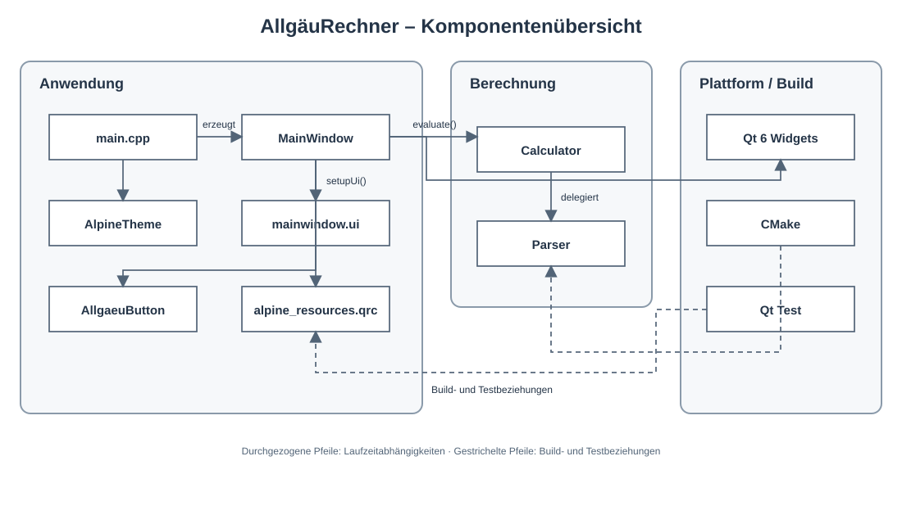
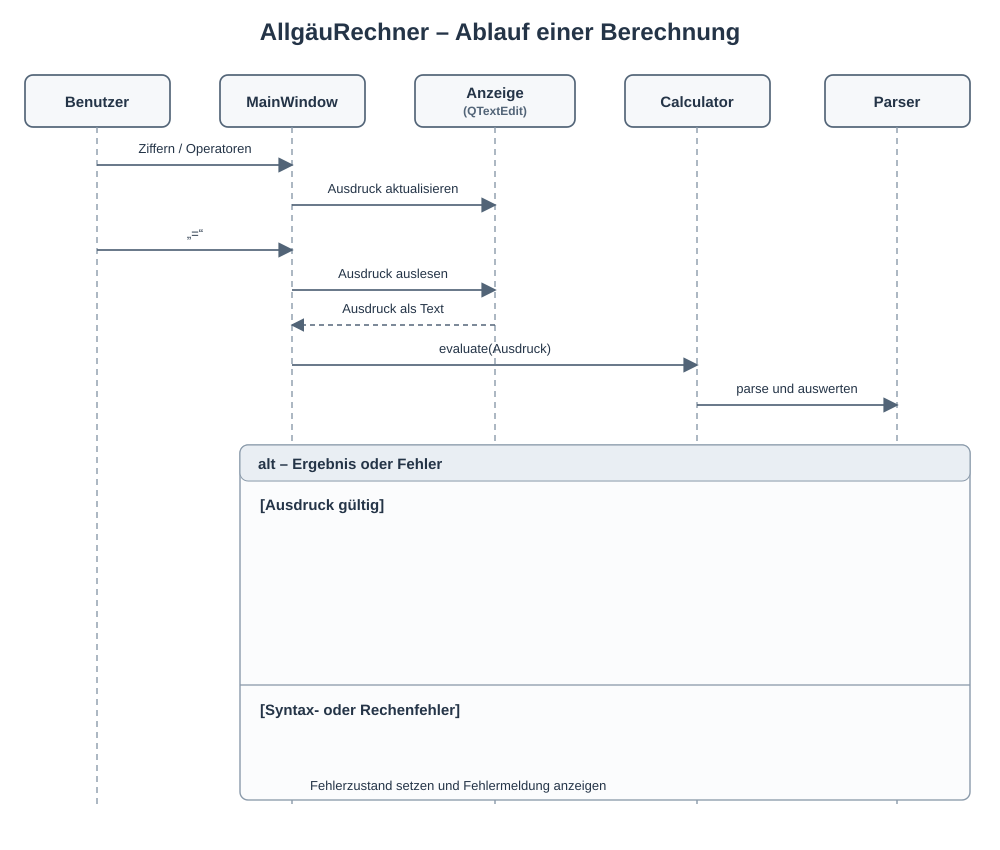

# Technisches Design – AllgäuRechner

> **Dokumenttyp:** Software-Designbeschreibung  
> **Projekt:** AllgäuRechner  
> **Stand:** 22. November 2026  
> **Implementierungsbasis:** Branch `double_factorial`  
> **Status:** Beschreibung des vorhandenen Entwurfs und der implementierten Architektur

## 1. Ziel und Geltungsbereich

Der AllgäuRechner ist ein wissenschaftlicher Taschenrechner mit grafischer Benutzeroberfläche. Er ermöglicht die Eingabe vollständiger mathematischer Ausdrücke und deren Auswertung. Neben den Grundrechenarten werden wissenschaftliche Funktionen, mathematische Konstanten und kombinatorische Operationen unterstützt.

Dieses Dokument beschreibt den technischen Aufbau der Anwendung, die Verantwortlichkeiten ihrer wesentlichen Komponenten, den Weg eines Rechenausdrucks durch das System sowie die wichtigsten Entwurfsentscheidungen. Es ergänzt die [Bedienungsanleitung](BEDIENUNGSANLEITUNG.md), die sich an Anwenderinnen und Anwender richtet.

Die Beschreibung bezieht sich auf den genannten Implementierungsstand. Sie ist keine Zusicherung, dass jede denkbare Erweiterung bereits umgesetzt ist. Wo eine saubere konzeptionelle Trennung beschrieben wird, ist zwischen vorhandener Implementierung und möglicher Weiterentwicklung zu unterscheiden.

## 2. Entwurfsziele

Die Architektur verfolgt folgende Ziele:

- **Einfache Bedienung:** Mathematische Ausdrücke sollen über Bildschirmtasten und – auf unterstützten Plattformen – über die Tastatur eingegeben und korrigiert werden können.
- **Ausdrucksorientierte Berechnung:** Der Rechner wertet nicht nur einzelne Tastendrücke aus, sondern interpretiert einen vollständigen mathematischen Ausdruck.
- **Trennung der Verantwortlichkeiten:** Die Oberfläche verwaltet Eingabe und Darstellung; die Klasse `Calculator` übernimmt die syntaktische und mathematische Auswertung.
- **Plattformübergreifende Nutzung:** Qt 6 und CMake ermöglichen Desktop- und Android-Builds aus einer gemeinsamen Codebasis.
- **Nachvollziehbarkeit und Testbarkeit:** Die mathematische Logik und die GUI sollen reproduzierbar überprüft werden können.
- **Erweiterbarkeit:** Neue Operatoren und Funktionen sollen möglichst lokal im Parser und in der Bedienoberfläche ergänzt werden können.

## 3. Systemüberblick

Die Anwendung besteht im Wesentlichen aus drei Ebenen:

1. **Präsentation:** Qt-Hauptfenster, Anzeige, Tasten, Layout, alpine Gestaltung und Dialoge.
2. **Interaktionssteuerung:** Verarbeitung der Tastenaktionen, Verwaltung des aktuellen Ausdrucks, Cursor, Verlauf, INV- und Winkelmodus sowie Ergebnisformatierung.
3. **Berechnung:** Parser und mathematische Auswertung in der Klasse `Calculator`.

Die Anwendung wird über `main.cpp` gestartet. Dort werden eine `QApplication` und das `MainWindow` erzeugt. Die eigentliche Oberfläche wird aus der Qt-Designer-Datei `mainwindow.ui` aufgebaut.

### 3.1 Technisches Umfeld

| Bereich | Technologie / Umsetzung |
| --- | --- |
| Programmiersprache | C++14 |
| GUI-Framework | Qt 6 (Core, Widgets) |
| UI-Definition | Qt Designer, `mainwindow.ui` |
| Build-System | CMake |
| Rechnerkern | `Calculator` in `common/Util.h` |
| Desktop-Tests | Qt Test / GUI-Tests |
| Android | Qt Android, ARM64-Paket |
| CI/CD | GitHub Actions |

## 4. Architektur und Komponenten

### 4.1 Startpunkt – `main.cpp`

Der Programmeinstieg erzeugt die Qt-Anwendung, instanziiert das Hauptfenster, zeigt es an und startet die Event-Schleife. Die Startdatei enthält bewusst keine Berechnungslogik.

### 4.2 Hauptfenster – `MainWindow`

`MainWindow` ist die zentrale Steuerung der grafischen Anwendung. Es bindet die in `mainwindow.ui` definierte Oberfläche ein und verbindet Bedienelemente mit den jeweiligen Aktionen.

Zu seinen Aufgaben gehören insbesondere:

- Entgegennahme von Tastenaktionen und Tastatureingaben
- Aufbau und Änderung des angezeigten Ausdrucks
- Positionierung und Pflege des Textcursors
- Auslösen der Berechnung über `Calculator::evaluate()`
- Umschalten der inversen Tastenfunktionen
- Umschalten zwischen Grad- und Radiantmodus
- Pflege des einfachen Berechnungsverlaufs
- Formatierung des angezeigten Ergebnisses
- Verwaltung der Einstellung für Nachkommastellen
- Anzeige der Unterstützungs- und Einstellungsdialoge

Die Tastenaktionen werden über die interne Aktionstypisierung `CalculatorAction` zusammengeführt. Die konkrete Oberfläche bleibt damit von der semantischen Bedeutung einer Aktion unterscheidbar: Eine Aktion wie `Factorial` beschreibt beispielsweise die gewünschte Rechnerfunktion und nicht die grafische Darstellung der Taste.

Der aktuelle Ausdruck wird in `m_strExpression` geführt und mit dem Inhalt des Anzeige-Editors synchronisiert. Weitere Zustände umfassen unter anderem Fehlerstatus, INV-Zustand, Cursorposition, Nachkommastellen und Verlauf.

### 4.3 Oberfläche – `mainwindow.ui`

Die Datei `mainwindow.ui` enthält die deklarative Beschreibung des Hauptfensters und seiner Bedienelemente. Die Oberfläche wird zur Build-Zeit durch Qt in C++-Code überführt und über `ui->setupUi(this)` initialisiert.

Die Verwendung von Qt Designer ist eine bewusste Entwurfsentscheidung: Layout und Anordnung der Bedienelemente sollen visuell bearbeitet werden können, ohne die gesamte Oberfläche programmatisch aufzubauen.

### 4.4 Gestaltungskomponenten

Die Gestaltung ist in eigene Komponenten ausgelagert:

- `AlpineTheme`: themenbezogene Gestaltung und visuelle Regeln.
- `AllgaeuButton`: spezialisierte Taste mit zusätzlichem Zustand für alternative Beschriftung bzw. alternative Darstellung.
- `alpine_resources.qrc`: Einbindung der grafischen Ressourcen in die Anwendung.

Der alternative Tastenstatus ist insbesondere für die INV-Funktion wichtig. Die Taste kann so ihre sichtbare Bedeutung wechseln, ohne dass dafür ein zweites Bedienelement benötigt wird.

### 4.5 Rechnerkern – `Calculator`

Die Klasse `Calculator` ist in `common/Util.h` implementiert. Sie stellt mit `evaluate(expression)` die zentrale Schnittstelle zur Auswertung eines Ausdrucks bereit.

Der Rechnerkern hält den Winkelmodus und den Zustand der inversen Prozentrechnung. Die Auswertung selbst erfolgt durch einen internen Parser. Die mathematische Logik ist damit nicht an Qt-Widgets gebunden.

Die Implementierung liegt derzeit in einer Header-Datei. Eine spätere Aufteilung in eigene Header- und Quelldateien wäre möglich, ist aber keine Voraussetzung für das bestehende Schnittstellendesign.

## 5. Komponentenübersicht

Das folgende Diagramm zeigt die wesentlichen Abhängigkeiten der Anwendung. Die Pfeile bezeichnen die Nutzung bzw. Abhängigkeit einer Komponente.

*PlantUML-Quelldatei: [components.puml](diagrams/components.puml)*

## 6. Klassendiagramm

Das Klassendiagramm zeigt die zentralen Klassen und ihre Beziehungen. Der Parser ist als private, innerhalb von `Calculator` definierte Klasse implementiert. `MainWindow` hält eine Instanz des Rechners und nutzt die Qt-Designer-Oberfläche. `AllgaeuButton` erweitert `QPushButton`.

*PlantUML-Quelldatei: [class-diagram.puml](diagrams/class-diagram.puml)*

## 7. Ablauf einer Berechnung

Ein Ausdruck wird zunächst in der Anzeige aufgebaut. Die Eingabe kann von den Bildschirmtasten oder über die Tastatur stammen. Beim Auslösen der Berechnung liest das Hauptfenster den vollständigen Text aus dem Anzeige-Editor und übergibt ihn an den Rechnerkern.

Der Parser verarbeitet den Ausdruck und liefert entweder einen numerischen Wert oder eine Ausnahme. Das Hauptfenster übernimmt anschließend die Darstellung des Ergebnisses oder der Fehlermeldung.

*PlantUML-Quelldatei: [calculation-flow.puml](diagrams/calculation-flow.puml)*

## 8. Mathematischer Parser

Die vollständige formale Grammatik in BNF, einschließlich Operatorpräzedenz, Assoziativität und semantischer Bedingungen, ist in der [Parser-Dokumentation](PARSER.md) beschrieben.

### 7.1 Grundprinzip

Der Rechnerkern verwendet einen rekursiven Parser (Recursive-Descent-Parser). Die Grammatik wird durch mehrere Parse-Funktionen abgebildet, die jeweils eine Ebene der Operatorpräzedenz behandeln.

Der Parser liest den Ausdruck von links nach rechts. Er überspringt Leerzeichen, erkennt Zahlen und Funktionsnamen, verarbeitet Klammern und prüft am Ende, ob der gesamte Ausdruck verbraucht wurde. Unerwartete Restzeichen führen zu einem Syntaxfehler.

### 7.2 Operatoren und Funktionen

Der implementierte Funktionsumfang umfasst unter anderem:

| Kategorie | Operatoren / Funktionen |
| --- | --- |
| Grundrechenarten | `+`, `-`, `*`, `/` |
| Rest einer Division | `mod` |
| Prozent | `%` |
| Potenz | `^` |
| Wurzel | `root`, `sqrt()` |
| Fakultät | `!` |
| Doppelfakultät | `!!` |
| Kombinatorik | `nCr` |
| Trigonometrie | `sin()`, `cos()`, `tan()` |
| Umkehrfunktionen | `asin()`, `acos()`, `atan()` |
| Logarithmen | `log()`, `ln()` |
| Weitere Funktionen | `exp()`, `edx()` |
| Konstanten | `pi`, `e` |

Die genaue Schreibweise im Ausdruck ist die interne Parsernotation. Die Oberfläche kann dafür mathematisch gestaltete Symbole anzeigen.

### 7.3 Präzedenz und Assoziativität

Die Aufteilung in Parse-Funktionen legt fest, in welcher Reihenfolge Operationen ausgeführt werden. Insbesondere gelten folgende Regeln:

- Multiplikation und Division binden stärker als Addition und Subtraktion.
- Potenzierung ist rechtsassoziativ: `2^3^2` wird als `2^(3^2)` ausgewertet.
- Vorzeichen binden weniger stark als Potenzen: `-2^2` bedeutet `-(2^2)`.
- Ein negatives Exponentenvorzeichen ist zulässig: `2^-3`.
- Fakultät und Doppelfakultät sind Postfix-Operatoren und werden nach ihrem Operanden ausgewertet.
- Klammern erlauben die explizite Gruppierung von Teilausdrücken.

### 7.4 Fakultät und Doppelfakultät

Die Fakultät wird durch ein einzelnes Ausrufezeichen dargestellt:

`n! = n · (n-1) · ... · 2 · 1`

Die Doppelfakultät verwendet zwei unmittelbar aufeinanderfolgende Ausrufezeichen. Dabei wird jeweils nur jede zweite Zahl berücksichtigt:

- `5!! = 5 · 3 · 1 = 15`
- `6!! = 6 · 4 · 2 = 48`

Die beiden Operatoren sind syntaktisch getrennt. Der Parser erkennt nach dem ersten `!`, ob direkt ein zweites `!` folgt. Die Doppelfakultät ist daher nicht mit einer zweimaligen Anwendung der Fakultät zu verwechseln.

### 7.5 Inverse Fakultät

Die inverse Fakultätsfunktion ist eine Bedienfunktion der INV-Tastenbelegung. Sie sucht zu einer positiven ganzen Zahl die größte Fakultät, die nicht größer als die Eingabe ist, und ergänzt gegebenenfalls den verbleibenden Rest.

Beispiele:

| Eingabe | Zerlegung |
| ---: | --- |
| `5042` | `7! + 2` |
| `5402` | `7! + 362` |
| `720` | `6!` |

Ein Rest von null wird nicht angezeigt. Die inverse Fakultät ist von der mathematischen Doppelfakultät zu unterscheiden: Sie ist eine Zerlegung einer Zahl in Fakultätswert plus Rest und kein weiterer Postfix-Operator.

### 7.6 Winkelmodus und inverse Funktionen

Trigonometrische Funktionen verwenden standardmäßig Grad. Über den Winkelmodus kann auf Radiant umgeschaltet werden. Der Modus wird vom Hauptfenster an den Rechnerkern übergeben.

Die INV-Taste schaltet alternative Funktionen frei, beispielsweise Arkussinus statt Sinus. Der INV-Zustand ist ein Bedienzustand; die eigentliche Berechnung wird weiterhin durch den Rechnerkern ausgeführt.

## 9. Zustands- und Eingabeverwaltung

Das Hauptfenster hält den Zustand der Interaktion. Dazu gehören:

- aktueller Ausdruck und Anzeigeinhalt
- Fehlerstatus
- INV-Zustand
- Winkelmodus im Rechnerkern
- Cursorposition
- Verlaufseinträge und aktuelle Verlaufsposition
- eingestellte Anzahl der Nachkommastellen

Die Eingabe wird an der Cursorposition eingefügt. Cursorbewegung und Rücktaste arbeiten deshalb auf dem Texteditor und nicht nur am Ende des Ausdrucks.

Die Nachkommastelleneinstellung wird über `QSettings` gespeichert. Der zulässige Bereich beträgt 0 bis 15. Die Einstellung beeinflusst die Formatierung des Ergebnisses, nicht die interne mathematische Genauigkeit.

Die Ergebnisformatierung entfernt überflüssige abschließende Nullen. Für sehr große Werte wird eine wissenschaftliche Schreibweise verwendet.

## 10. Fehlerbehandlung und numerische Grenzen

Der Parser unterscheidet Syntaxfehler und mathematisch nicht definierte Operationen. Beispiele sind:

- leere oder unvollständige Ausdrücke
- unerwartete Zeichen oder fehlerhafte Klammerung
- Division oder Modulo durch null
- Fakultät einer negativen oder nicht ganzzahligen Zahl
- nicht definierte Wurzel- oder Logarithmusargumente
- Überlauf bei numerischen Berechnungen
- Überschreitung der zulässigen Parser-Verschachtelung

Fehler werden über C++-Ausnahmen an die GUI weitergegeben. Das Hauptfenster fängt diese ab, setzt den Fehlerzustand und zeigt die Fehlermeldung in der Anzeige an. Eine anschließende neue Eingabe oder das Löschen ermöglicht den Neustart einer Berechnung.

Die Berechnung basiert auf Gleitkommaarithmetik. Daher sind Rundungsabweichungen bei bestimmten Dezimalwerten möglich. Die Anzahl der angezeigten Nachkommastellen ist nicht mit der internen Rechengenauigkeit gleichzusetzen.

## 11. Build und Plattformen

Das Projekt verwendet CMake und Qt 6. Die CMake-Konfiguration aktiviert die Qt-Automatisierung für MOC, UIC und RCC. Dadurch werden Qt-Metadaten, die Designer-Oberfläche und Ressourcen während des Builds verarbeitet.

Für Android werden die Paketinformationen und SDK-Zielwerte über die CMake-Konfiguration gesetzt. Das Projekt ist auf ein Android-ARM64-Paket ausgerichtet. Auf Desktop-Systemen werden zusätzlich die GUI-Tests und – sofern verfügbar – das Qt-Designer-Plugin für `AllgaeuButton` gebaut.

Die GitHub-Actions-Workflows übernehmen Build, Tests und den Android-Paketierungsprozess. Versionsinformationen werden aus der Datei `VERSION` gelesen.

## 12. Qualitätssicherung und Tests

Die Tests prüfen sowohl mathematisches Verhalten als auch die Interaktion der GUI. Zu den relevanten Testbereichen gehören:

- Grundrechenarten und Operatorpräzedenz
- Klammern, negative Exponenten und verschachtelte Ausdrücke
- Grad- und Radiantmodus
- trigonometrische Umkehrfunktionen
- Fakultät, Doppelfakultät und inverse Fakultät
- Binomialkoeffizient
- numerische Grenzfälle und Überläufe
- Parser-Verschachtelungsgrenze
- Cursorbewegung, Rücktaste und Verlauf
- Fehleranzeige und Erholung nach fehlerhaften Ausdrücken

Die GUI-Tests werden auf Desktop-Systemen mit Qt Test ausgeführt. Die Tests sollten bei Änderungen am Parser und an der Tastenbelegung gemeinsam betrachtet werden: Eine korrekte mathematische Funktion allein garantiert noch nicht, dass die entsprechende Taste den richtigen Ausdruck erzeugt.

## 13. Wesentliche Entwurfsentscheidungen

### 12.1 Ausdruck statt unmittelbarer Einzeloperation

Die Eingabe wird als vollständiger Ausdruck behandelt. Das ermöglicht Klammern, verschachtelte Funktionen und eine einheitliche Operatorpräzedenz. Die GUI muss dadurch nicht selbst die Reihenfolge der Rechenoperationen implementieren.

### 12.2 Qt-Oberfläche und Berechnung getrennt halten

Der Rechnerkern soll unabhängig von Widgets bleiben. Das vereinfacht mathematische Tests und hält die Berechnungslogik unabhängig von der konkreten Plattformdarstellung.

### 12.3 Oberfläche deklarativ gestalten

Die Verwendung von Qt Designer hält die Anordnung der Oberfläche bearbeitbar. Spezialisierte Widgets wie `AllgaeuButton` ergänzen die Standard-Widgets nur dort, wo das Verhalten es erfordert.

### 12.4 Alternative Tastenfunktionen

Die INV-Funktion nutzt einen alternativen Zustand der jeweiligen Taste. Damit bleibt die Bedienoberfläche kompakt und die Zuordnung von Grund- und Zusatzfunktion sichtbar.

### 12.5 Grenzen explizit prüfen

Der Parser prüft ungültige mathematische Eingaben, numerische Überläufe und zu tiefe Verschachtelung. Damit werden Fehler möglichst früh erkannt und nicht als scheinbar gültige Ergebnisse dargestellt.

## 14. Mögliche Weiterentwicklung

Die folgenden Punkte sind Ansatzpunkte für spätere Architekturarbeit und keine Behauptung über bereits implementierte Funktionen:

- Parser und Rechnerkern bei wachsendem Umfang in eigene Dateien aufteilen.
- GUI-Zustandsverwaltung weiter von der Darstellung entkoppeln.
- Eine explizite Grammatikdokumentation und gezielte Parser-Tests ergänzen.
- Berechnungsverlauf und Einstellungen bei Bedarf um Import/Export erweitern.
- Numerische Datentypen und Genauigkeitsgrenzen für wissenschaftliche Anwendungsfälle weiter untersuchen.
- Barrierefreiheit, Tastaturnavigation und Internationalisierung systematisch prüfen.

## 15. Verzeichnis- und Dateiorientierung

| Pfad | Verantwortung |
| --- | --- |
| `instructor/Calculator_cmake/main.cpp` | Programmeinstieg |
| `instructor/Calculator_cmake/mainwindow.h` | Hauptfenster-Schnittstelle und Aktionsdefinitionen |
| `instructor/Calculator_cmake/mainwindow.cpp` | GUI-Steuerung und Interaktionslogik |
| `instructor/Calculator_cmake/mainwindow.ui` | Qt-Designer-Oberfläche |
| `instructor/Calculator_cmake/AlpineTheme.h/.cpp` | Alpine Gestaltung |
| `instructor/Calculator_cmake/AllgaeuButton.h/.cpp` | Spezialisierte Rechner-Taste |
| `instructor/Calculator_cmake/alpine_resources.qrc` | Eingebundene Ressourcen |
| `instructor/Calculator_cmake/UnitTests/` | GUI-Tests |
| `common/Util.h` | Rechnerkern und Parser |
| `VERSION` | Projektversion |
| `.github/workflows/` | CI/CD-Workflows |

---

**Weiterführende Dokumentation:** [Bedienungsanleitung](BEDIENUNGSANLEITUNG.md) · [Projektübersicht](../README.md)
